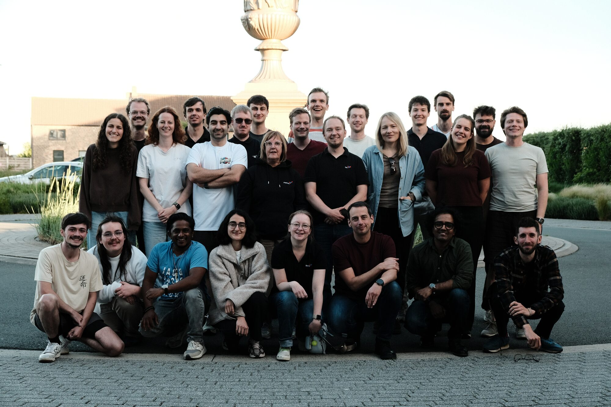

```{=html}
<div class="page-hero-band">
  
  <div class="page-hero-overlay"></div>
  <div class="page-hero-content">
    <h1 class="page-hero-title">Team</h1>
    <p class="page-hero-sub">Researchers, developers, and support staff of the CompOmics group.</p>
  </div>
</div>
<script>
(function () {
  function alignHero() {
    var ref = document.querySelector('.team-section-title');
    var content = document.querySelector('.page-hero-content');
    var band = document.querySelector('.page-hero-band');
    if (!ref || !content || !band) return;
    var offset = ref.getBoundingClientRect().left - band.getBoundingClientRect().left;
    content.style.paddingLeft = Math.max(16, offset) + 'px';
  }
  document.addEventListener('DOMContentLoaded', alignHero);
  window.addEventListener('resize', alignHero);
})();
</script>
```

```{=html}
<section class="team-shell">
  <div class="team-shell-intro">

```

::: {#team}
:::

```{=html}
  <div class="team-network-cta">
    <p class="network-intro">Beyond the current team, CompOmics is part of a wider network of affiliated members, close collaborators, and former colleagues.</p>
    <a href="network.html" class="network-btn"><i class="bi bi-people" aria-hidden="true"></i> Alumni &amp; collaborators</a>
  </div>
</section>

<script>
(function () {
  const cards = Array.from(document.querySelectorAll('.team-card[data-member]'));
  if (!cards.length) return;

  let activeCard = null;

  function getLastWrapInRow(clickedCard, grid) {
    const wraps = Array.from(grid.querySelectorAll(':scope > .team-card-wrap'));
    const cr = clickedCard.getBoundingClientRect();
    let lastWrap = clickedCard.closest('.team-card-wrap');
    wraps.forEach(function(wrap) {
      const btn = wrap.querySelector('.team-card');
      if (btn) {
        const br = btn.getBoundingClientRect();
        if (br.top < cr.bottom && cr.top < br.bottom) {
          lastWrap = wrap;
        }
      }
    });
    return lastWrap;
  }

  function buildExpander(card) {
    const expander = document.createElement('div');
    expander.className = 'team-profile-expander';
    expander.innerHTML = card.closest('.team-card-wrap').querySelector('.team-profile').innerHTML;
    return expander;
  }

  function openExpander(card, grid) {
    const expander = buildExpander(card);
    const lastWrap = getLastWrapInRow(card, grid);
    lastWrap.after(expander);

    requestAnimationFrame(function() {
      const cardRect = card.getBoundingClientRect();
      const expanderRect = expander.getBoundingClientRect();
      if (expanderRect.width > 0) {
        expander.style.setProperty('--notch-x', (cardRect.left + cardRect.width / 2 - expanderRect.left) + 'px');
      }

      expander.style.maxHeight = expander.scrollHeight + 'px';
      expander.style.opacity = '1';

      expander.addEventListener('transitionend', function onEnd(e) {
        if (e.propertyName !== 'max-height') return;
        expander.removeEventListener('transitionend', onEnd);
        expander.style.maxHeight = 'none';
        expander.style.overflow = 'visible';
      });
    });

    card.classList.add('is-selected');
    activeCard = card;
  }

  function closeExpander(expander, onDone) {
    expander.style.overflow = 'hidden';
    expander.style.maxHeight = expander.scrollHeight + 'px';
    requestAnimationFrame(function() {
      expander.style.maxHeight = '0';
      expander.style.opacity = '0';
      expander.addEventListener('transitionend', function onEnd(e) {
        if (e.propertyName !== 'max-height') return;
        expander.removeEventListener('transitionend', onEnd);
        expander.remove();
        if (onDone) onDone();
      });
    });
  }

  cards.forEach(function(card) {
    card.addEventListener('click', function() {
      const grid = card.closest('.team-grid');
      const existing = grid.querySelector('.team-profile-expander');
      const sameCard = activeCard === card;

      cards.forEach(function(c) { c.classList.remove('is-selected'); });
      activeCard = null;

      if (existing) {
        if (sameCard) {
          closeExpander(existing);
          return;
        }
        existing.remove();
      }

      openExpander(card, grid);
    });
  });

  // open a member's profile automatically when linked to via #member-<key>
  // (e.g. from a tool's dev avatar on the tools page)
  function openFromHash() {
    const match = window.location.hash.match(/^#member-(.+)$/);
    if (!match) return;
    const card = cards.find(function (c) { return c.dataset.member === match[1]; });
    if (!card || activeCard === card) return;
    card.click();
    requestAnimationFrame(function () {
      card.scrollIntoView({ behavior: 'smooth', block: 'center' });
    });
  }

  openFromHash();
  window.addEventListener('hashchange', openFromHash);
})();
</script>
```
